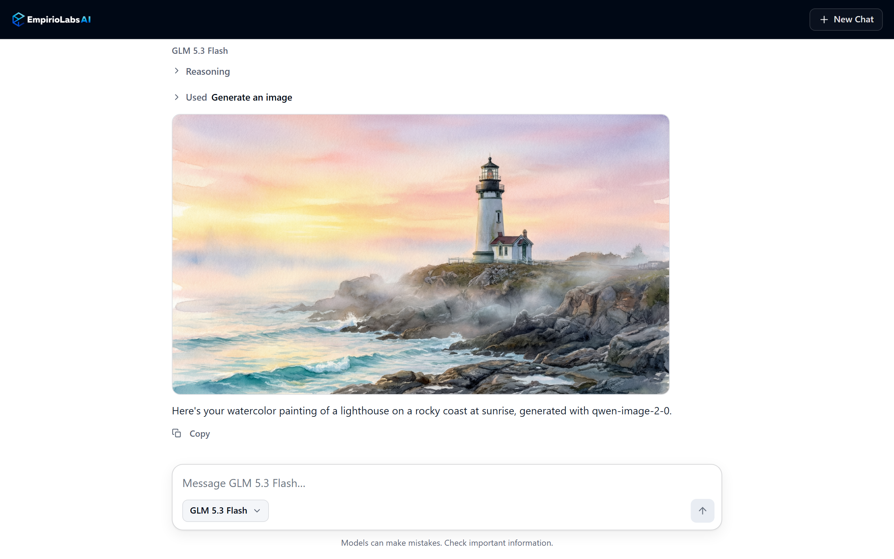
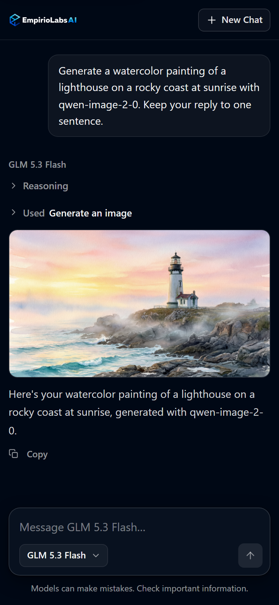

# EmpirioLabs AI Agent

An AI agent for [EmpirioLabs AI](https://empiriolabs.ai), built with Next.js and the AI SDK. Chat with any model in the live EmpirioLabs AI catalog, and let the agent use every EmpirioLabs AI tool: generate images, video, 3D assets, speech and music, transcribe audio, read documents, search the web, compare models, run agent tasks and more. The tools come from the live tool list of the EmpirioLabs AI MCP server, so new tools appear without a code change.

[](https://vercel.com/new/clone?repository-url=https%3A%2F%2Fgithub.com%2FEmpirioLabs-AI%2Fempiriolabs-agent&project-name=empiriolabs-agent&repository-name=empiriolabs-agent&integration-ids=oac_G0yRAQMkKnlHKtLYN9aNXLSD&skippable-integrations=1)
[](https://railway.com/deploy/empiriolabs-ai-chatbot?referralCode=FR-gwI&utm_medium=integration&utm_source=template&utm_campaign=generic)

<p>
  
  
</p>

## Features

- **Every EmpirioLabs AI tool.** A reply can use the tools of the EmpirioLabs AI MCP server: image, video and 3D generation, image editing and analysis, speech, music and sound, transcription, document reading (OCR), web search, research and grounded answers, embeddings and reranking, the model catalog, jobs and agent tasks. The app reads the server's tool list for every request, so a tool added to the server is available right away.
- **Media in the chat.** Images, video and audio that a tool creates appear in the reply. Each tool call shows as a line, such as **Used** Generate an image, that opens to its input and result.
- **Live model list.** The model picker reads the EmpirioLabs AI catalog when the page loads and lists its text models by author, so new models appear without a code change. Models that do not call tools are marked "chat only" and answer as a plain chat.
- **Streaming replies.** Replies stream in as Markdown with lists, tables and code blocks. When a model returns its reasoning, it appears in a section you can expand.
- **Sign in with EmpirioLabs AI.** Without a key of its own, the app asks each visitor to sign in with their EmpirioLabs AI account, and their usage is billed to their account. Visitors can also continue with an API key of their own.
- **Keys stay on the server.** `EMPIRIOLABS_API_KEY` is read only on the server and is never sent to the browser. In sign-in mode, the visitor's access token, or the API key they entered, is kept in an HttpOnly cookie that the page's scripts cannot read.
- **Ready for every screen.** Light and dark themes follow the system setting, the layout works from phones to wide screens, and every control has an accessible label and works from the keyboard.
- **No analytics or tracking.**

## Deploy

### Vercel

Select **Deploy with Vercel**. To let each visitor sign in with their own EmpirioLabs AI account, skip the EmpirioLabs AI step during setup: the app starts in sign-in mode. To use one key for every visitor instead, connect [EmpirioLabs AI on Vercel](https://vercel.com/integrations/empiriolabs) during setup to create an API key for the new project as `EMPIRIOLABS_API_KEY`, or add a key you already have under **Settings > Environment Variables** and redeploy.

### Railway

Select **Deploy on Railway** and enter your API key as `EMPIRIOLABS_API_KEY`. Railway builds the app and gives it a public domain. To switch the deployment to sign-in mode, remove `EMPIRIOLABS_API_KEY` from the service's variables.

## Environment variables

| Variable | Required | Description |
| --- | --- | --- |
| `EMPIRIOLABS_API_KEY` | No | Set it to use one key for every visitor, for a private deployment: your API key from the [API keys page](https://platform.empiriolabs.ai/dashboard/api-keys). Read only on the server. The chat and the tools both use it. Without it, the app runs in sign-in mode. |
| `APP_URL` | No | The app's public https address, such as `https://agent.example.com`. Sign-in uses it for the app's client ID and return address. Without it, the app uses the address each request arrives at. |
| `EMPIRIOLABS_MODEL` | No | The model ID or alias the chat starts with, such as `glm-5-3-flash`. Without it, the chat starts with the catalog's first featured chat model. |
| `EMPIRIOLABS_TOOLS` | No | `false` turns the EmpirioLabs AI tools off, so the app is a plain chat. Tools are on by default. |
| `DEMO_MODE` | No | `true` uses sign-in mode even when `EMPIRIOLABS_API_KEY` is set. |

Visitors can also open the chat with a model chosen in the address, for example `/?model=glm-5-3-flash`.

## Run locally

You need Node.js 24 and an EmpirioLabs AI API key.

```bash
git clone https://github.com/EmpirioLabs-AI/empiriolabs-agent.git
cd empiriolabs-agent
npm ci
cp .env.example .env.local
```

Set `EMPIRIOLABS_API_KEY` in `.env.local`, then start the development server:

```bash
npm run dev
```

Open [http://localhost:3000](http://localhost:3000). To run the production build, use `npm run build` and then `npm run start`.

Sign-in mode needs the app at an https address that EmpirioLabs AI can reach, so on your computer the app runs with a key. To try sign-in, deploy the app.

## Tools

The agent connects to the [EmpirioLabs AI MCP server](https://docs.empiriolabs.ai/mcp) at `https://mcp.empiriolabs.ai/mcp/models+text+search+media+jobs+agents`, with the same API key as the chat. That address serves the toolsets for the model catalog, text models, search, media, jobs and agent tasks, and each tool keeps its normal time limit. GPU Cloud, Hosted Agents and batches are left out; manage them from the [dashboard](https://platform.empiriolabs.ai/dashboard).

- **What the agent can use.** Every tool in that live tool list, except the tools the server marks as destructive, such as deleting a voice or cancelling a job. With the deployment's own key, which every visitor shares, the agent also leaves out the tools that read the account's records (its usage history and its job list). In sign-in mode, each visitor gets them for their own account. To change which tools the agent gets, edit `isAllowed` in [`lib/mcp.ts`](lib/mcp.ts).
- **Longer work.** A tool that needs more time returns a job, and the agent reads its result with the **Get a job** tool. If a job is still running when a reply ends, the reply gives its job ID; ask the agent to check it later.
- **Credits.** Tool calls use credits from the account behind the API key, or in sign-in mode from the visitor's account, at the prices in the [model catalog](https://empiriolabs.ai/models). The tool definitions also add input tokens to each model call in a reply.
- **Files.** Generated files use signed links that expire. The page shows images, video and audio only from `https://media.empiriolabs.ai`.

## Public deployments

**Sign-in mode is the recommended way to share a deployment.** Leave `EMPIRIOLABS_API_KEY` unset, and each visitor signs in with their own EmpirioLabs AI account:

- The visitor approves the app on the EmpirioLabs AI consent screen (OAuth 2.1 with PKCE), and the app receives an access token for their account. Their chats and tool calls are billed to their account, at the same prices and limits as the API.
- The app keeps the access token in an HttpOnly cookie for 30 days. The page's scripts cannot read it, and only the app's server uses it. **Sign Out** revokes it.
- Visitors can disconnect the app at any time under **Settings > Connected applications** in the EmpirioLabs AI dashboard.
- Visitors can also select **Use an API key** under **Sign In** and continue with an API key of their own. The app checks the key with one read-only request, keeps it only in the same HttpOnly cookie, and never revokes it: **Sign Out** removes it from the browser, and the key keeps working everywhere else.
- The app identifies itself with a client metadata document at `/oauth/client.json`, and that URL is its client ID, so there is nothing to register. EmpirioLabs AI reads the document over https, so sign-in works at an https address anyone can open, such as your production domain, and not at a deployment behind a login, such as a Vercel preview deployment with Deployment Protection.

More in the [sign-in guide](https://docs.empiriolabs.ai/oauth).

With `EMPIRIOLABS_API_KEY` set, anyone who can open your deployment can use that key: they can chat and use every tool the agent offers, including paid image and video generation. Before you share such a deployment, choose one of these:

- **Your own sign-in.** Put the app behind your authentication.
- **A spending limit.** Give the deployment its own API key and set a spending limit on it on the [API keys page](https://platform.empiriolabs.ai/dashboard/api-keys).
- **No tools.** Set `EMPIRIOLABS_TOOLS=false` to offer chat only.

Every deployment also applies these limits, which you can change in [`lib/limits.ts`](lib/limits.ts):

- Chat, API key and sign-out requests sent from other websites are refused.
- Each IP address can send 20 chat requests a minute, and 20 sign-in, API key and sign-out requests a minute, counted on each server instance.
- A message can be up to 32,000 characters, a conversation up to 100 messages or 200,000 characters, and a request body up to 1 MB.
- A reply can make up to 10 model calls, with tool calls between them, and can run for up to 5 minutes. Each model call can write up to 16,384 tokens, or the model's own maximum when that is lower.
- Only models in the catalog list can be used, and a failed reply is sent again only when the visitor selects **Try Again**.

## How it works

| File | Role |
| --- | --- |
| `app/api/chat/route.ts` | Checks each request, picks the key (the visitor's access token in sign-in mode, otherwise `EMPIRIOLABS_API_KEY`), loads the tools, and streams the reply with `streamText`, which can call tools for up to 10 steps. Closes the MCP connection when the reply ends. |
| `app/api/auth/login/route.ts` | Starts sign-in: creates the `state` and the PKCE verifier, keeps them in a short-lived HttpOnly cookie, and sends the visitor to the EmpirioLabs AI consent screen. |
| `app/api/auth/callback/route.ts` | Checks the `state`, exchanges the code for the visitor's access token on the server, and keeps the token in an HttpOnly cookie. |
| `app/api/auth/key/route.ts` | Continues with an API key: checks its shape, checks it with one read-only request (`GET /v1/account/usage`), then keeps it in the same HttpOnly cookie as a sign-in. |
| `app/api/auth/logout/route.ts` | Revokes an access token from signing in, never an API key the visitor entered, and clears the cookies. |
| `app/oauth/client.json/route.ts` | The app's client metadata document. Its URL is the app's OAuth client ID. |
| `lib/oauth.ts` | The EmpirioLabs AI OAuth endpoints, the client metadata, PKCE, the code exchange and revocation. |
| `lib/session.ts` | The sign-in cookies, including whether the visitor signed in or entered an API key, and the visitor's token or key for the chat route. |
| `lib/origin.ts` | The app's public address for sign-in: `APP_URL`, or the address each request arrives at. |
| `lib/mcp.ts` | Connects to the EmpirioLabs AI MCP server with the API key that serves the request, reads its live tool list, and turns each tool result into text for the model and files for the page. |
| `lib/instructions.ts` | The agent's instructions, followed by the MCP server's own notes on its tools. |
| `lib/catalog.ts` | Reads `GET https://api.empiriolabs.ai/v1/models`, keeps the text models that answer on `/v1/chat/completions`, notes which of them call tools, and reuses the list for five minutes. |
| `lib/tool-output.ts` | The shape of a tool result, and the check that shows media only from `https://media.empiriolabs.ai`. |
| `components/tool-call.tsx` | Shows each tool call, and the images, video and audio it made. |
| `components/chat.tsx` | The chat interface, built on `useChat` from `@ai-sdk/react`, with **Sign In** and **Sign Out** in sign-in mode. |
| `components/api-key-option.tsx` | **Use an API key**: the form under **Sign In** for a visitor who continues with a key. |
| `components/chat-loader.tsx` | Loads the model list, the settings and whether the visitor is signed in, on the server for each request. |
| `lib/empiriolabs.ts` | Creates the EmpirioLabs AI provider and turns API errors into messages for the page. |

The model runs through the AI SDK's OpenAI-compatible provider with the EmpirioLabs AI base URL, and the tools come from the AI SDK's MCP client:

```ts
import { createMCPClient } from "@ai-sdk/mcp";
import { createOpenAICompatible } from "@ai-sdk/openai-compatible";
import { isStepCount, streamText } from "ai";

const apiKey = process.env.EMPIRIOLABS_API_KEY;

const empiriolabs = createOpenAICompatible({
  name: "empiriolabs",
  baseURL: "https://api.empiriolabs.ai/v1",
  apiKey,
});

const mcp = await createMCPClient({
  transport: {
    type: "http",
    url: "https://mcp.empiriolabs.ai/mcp/models+text+search+media+jobs+agents",
    headers: { Authorization: `Bearer ${apiKey}` },
  },
});

const result = streamText({
  model: empiriolabs.chatModel("glm-5-3-flash"),
  tools: await mcp.tools(),
  stopWhen: isStepCount(10),
  prompt: "Generate a watercolor image of a lighthouse at sunrise.",
  onEnd: () => mcp.close(),
});
```

More in the [AI SDK guide](https://docs.empiriolabs.ai/integrations#vercel-ai-sdk), the [MCP server guide](https://docs.empiriolabs.ai/mcp), the [model catalog](https://empiriolabs.ai/models) and the [documentation](https://docs.empiriolabs.ai).

## About EmpirioLabs AI

[EmpirioLabs AI](https://empiriolabs.ai) is specialized AI model hosting for open, proprietary, and custom stacks, plus GPU Cloud and hosted AI agents. Questions about this template: [support@empiriolabs.ai](mailto:support@empiriolabs.ai).

## License

[MIT](LICENSE)
